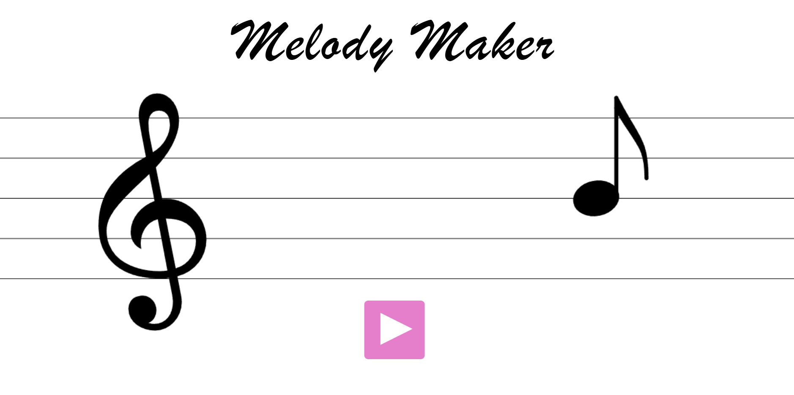
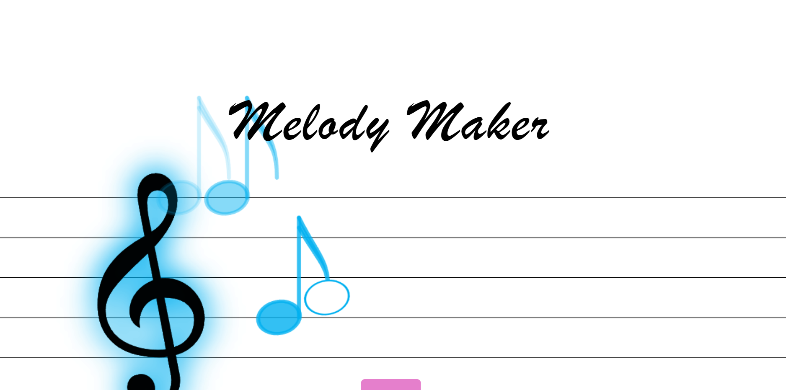
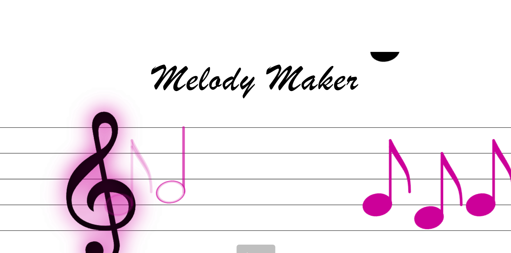

# MELODY MAKER

## WHAT IS IT?
melody maker made under 3KB works in your browsers address bar, it has a music staff and a treble clef. you move the mouse to pick a note, click it to send it to the treble clef, and the clef plays the sounds and glows when the note arrives. if you hold the mouse down, the note gets longer(quarter,half,whole). theres also a tune which you can hear by clicking the play button. its made with html canvas and js. 

## HOW TO MAKE MELODIES?
1. move the mouse to place the notes on the staff.
2. click to send it to the clef, where it plays.
3. hold to make the note longer, like eigth,quarter,half,whole.
4. you will hear the melodies as you put the notes on the staff.

bonus: it also has a existing melody, with few notes you can click the button to play and see how its done.

## THINGS TO ADD LATER
1. guide on how to play, when you open the page.
2. more existing melodies to play through.

## CREDITS
Thanks to valerie for minify script, it saved me. i shrunk my code down by 500 bytes approx. i have used non compliant uri to shrink it down so it wouldnt work on safari and ios as per my knowledge.

## SCREENSHOTS

